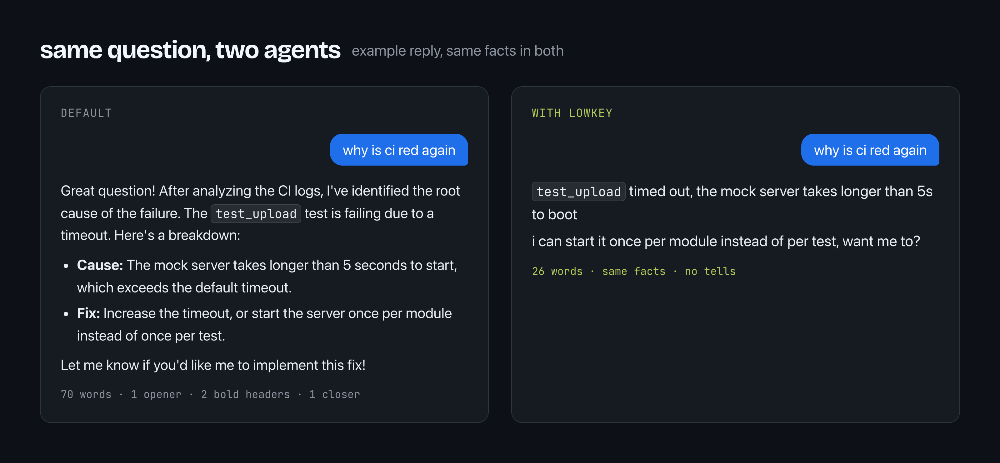

<p align="center">
  
</p>

<h1 align="center">lowkey</h1>

<p align="center">
  <em>Reads the room. Never says "Great question!"</em>
</p>

<p align="center">
  
  
  
  
</p>

<p align="center">
  
</p>

You know someone like this. Hoodie up, phone out. They read the last few messages before typing anything. Their review comments are two lines long and people actually do what they say. They have never once written "I hope this helps!"

lowkey puts them inside your agent.

## The problem

Agents write chat like a press release. "Great question!" before a one-line answer. Bold headers in a reply to a two-word message. Em dashes everywhere. "Let me know if you'd like me to..." at the end of everything. Claude said "You're absolutely right!" so often that [the bug report about it](https://github.com/anthropics/claude-code/issues/3382) got 870 thumbs up.

In your terminal that's just noise. In a PR thread or a Slack channel, people spot it in one line.

## What lowkey does

Before it writes, it reads who you're talking to: the last few comments in a PR thread, or how you type in your terminal. Then it copies their case, punctuation, length and emoji.

Every message gets one register. Work (GitHub, Slack, people you don't know) is short sentence case with contractions. Chat (DMs, friends, you typing lowercase at 2am) is lowercase, no full stops, a line per thought. Mixing the two is what reads fake, so it never does.

The tells go: openers, closers, clerk voice, em dashes, headers and bullets in chat, and answers longer than the question.

The facts stay. Code, identifiers, commands, paths, versions and error text come through exact, in backticks.

## The research

- We pulled 1,400 public GitHub comments from 2021-22 and 2025-26. In both, 86 to 87% of sentences start with a capital letter and the median comment is about 20 words. Lowercase with no full stops is a chat habit, so lowkey only goes lowercase where the room does.
- Over the same years, em dashes in those comments went from 0.11 to 1.31 per 1,000 words, about 12 times more in our sample, while capitals, full stops and length barely moved. Nothing else in the data changed that much, and it's the habit models are best known for. ([data and scripts](bench/))
- A full stop at the end of a short text makes it read as less sincere ([Gunraj et al., 2016](https://researchconnect.suny.edu/en/publications/texting-insincerely-the-role-of-the-period-in-text-messaging/)). On a 6 to 8 word reply the effect goes away (Kemp et al., 2025).
- Giving a model real examples from the conversation made its replies harder to tell apart from human ones, while describing a persona didn't help ([Pagan et al., 2025](https://arxiv.org/abs/2511.04195)). That's why lowkey mirrors instead of role-playing.
- "lol" mostly works as a softener, not a laugh (Schneebeli, 2020). lowkey uses it that way, at most once.

The full write-up, with every source, is in [docs/research.md](docs/research.md).

## How it works

```
1. who am I writing to?     read their last 3 to 5 messages
2. work or chat?            pick one register, never mix them
3. answer first             then the why, nothing they didn't ask for
4. strip the tells          no "Great question", no em dashes, no headers in chat
5. literals stay exact      code, paths, versions, errors
```

## Levels

| level | use it for | sounds like |
|---|---|---|
| `auto` | everything, it mirrors the room. The default | depends on the thread |
| `lite` | GitHub, Slack, maintainers you don't know | `Good catch, fixed in 3f9c2a1.` |
| `full` | DMs, friends, your own terminal | `i can start it once per module instead, want me to?` |
| `brainrot` | friends, and screenshots | `main is cooked but this branch passes 💀` |

Switch any time with `/lowkey lite`, `/lowkey full`, `/lowkey brainrot` or `/lowkey auto`. Turn it off with `/lowkey off` or just say "stop lowkey".

## Make it text like you

```
/lowkey-voice
```

Paste 10 to 40 messages you wrote, point it at a chat export, or let it read your recent GitHub comments. It works out your habits (capitals, full stops, which emoji, how you say thanks, how you disagree) and saves a short profile to `~/.claude/lowkey/voice.md`. Every session loads it after the defaults, and your profile wins where they disagree.

## Install

### Claude Code

```
/plugin marketplace add omlahore/lowkey
```
```
/plugin install lowkey@lowkey
```

Send them as two separate messages. This is the full version: always on, four levels, and it keeps your level across `/clear` and compaction. It runs two small Node hooks, so `node` needs to be on your PATH.

### Codex, Cursor, Gemini CLI, OpenCode and most other agents

```bash
npx skills add omlahore/lowkey
```

This installs the skill without the hooks, so say "lowkey" to switch it on.

### Always-on rules, no install

The same rules ship in the formats agents read from your repo: [`AGENTS.md`](AGENTS.md), [Cursor](.cursor/rules/lowkey.mdc), [Windsurf](.windsurf/rules/lowkey.md), [Cline](.clinerules/lowkey.md), [Copilot](.github/copilot-instructions.md) and [Kiro](.kiro/steering/lowkey.md). Copy the one your agent reads into your project.

## Configuration

| variable | default | what it does |
|---|---|---|
| `LOWKEY_DEFAULT_MODE` | `auto` | level at startup: `auto`, `lite`, `full`, `brainrot` or `off` |

A level you switch to mid-session survives `/clear`, resume and compaction. A fresh session starts at the default.

## Where it stays out of the way

Code, code comments, commit messages, PR and issue descriptions, docs, READMEs and anything written to a file come out normal. Security warnings, destructive steps and anything serious switch to plain, careful sentences, then lowkey picks back up.

## FAQ

**Will my agent start talking to me in lowercase?**
Only if you type in lowercase. `auto` mirrors you. If you'd rather it always use sentence case, set `LOWKEY_DEFAULT_MODE=lite`.

**Is this for passing off AI text as human?**
No. It changes the tone, not who wrote it. Some projects ask that replies in review threads be written without AI (Kubernetes is one), and their rules win.

**Does it work with caveman?**
caveman and lowkey both set how replies read, so pick one at a time. ponytail is about code and works fine alongside.

## Credits

The format follows [caveman](https://github.com/JuliusBrussee/caveman) and [ponytail](https://github.com/DietrichGebert/ponytail). The writing advice stands on the researchers cited in [docs/research.md](docs/research.md).

## License

MIT
